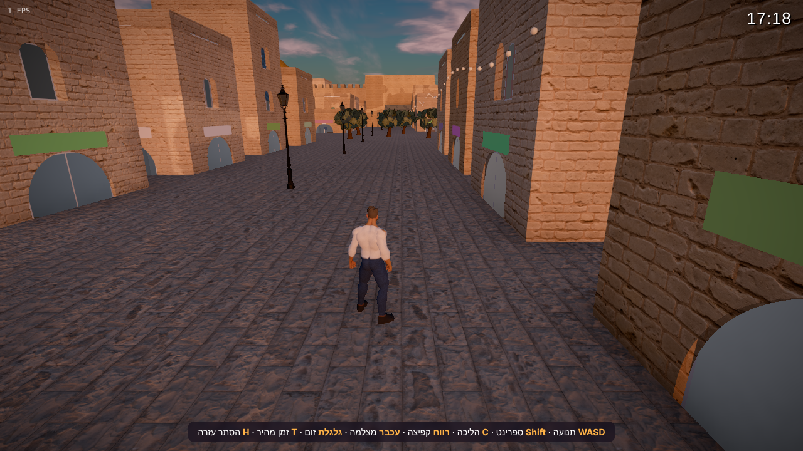
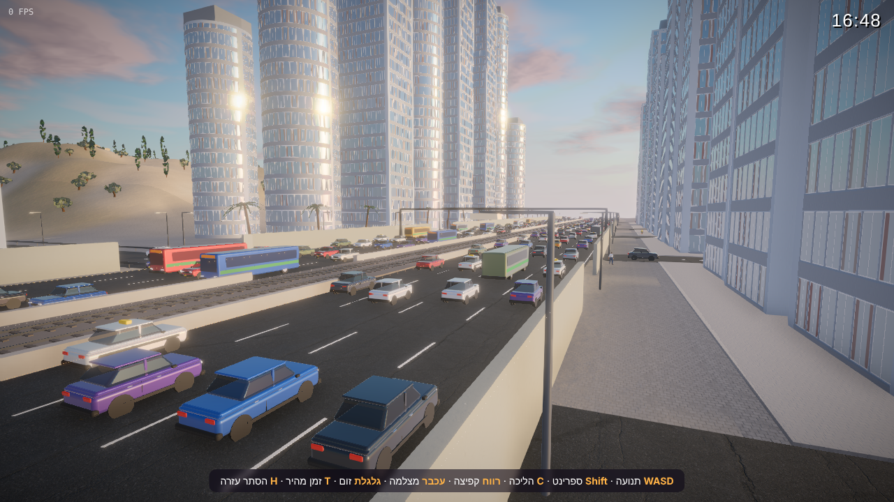
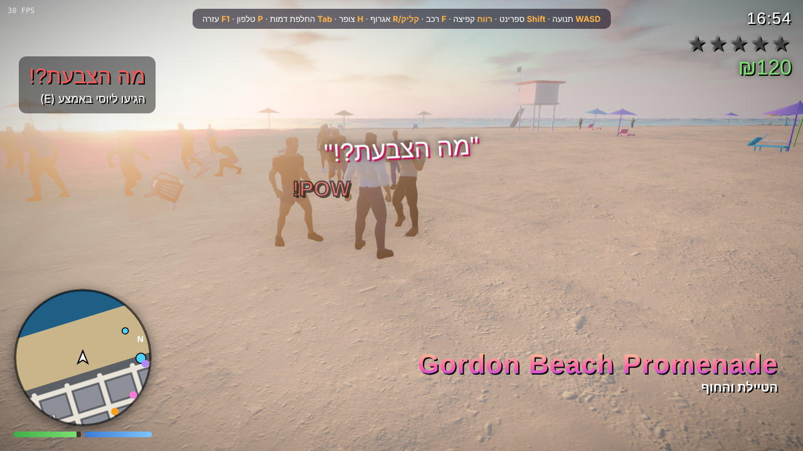
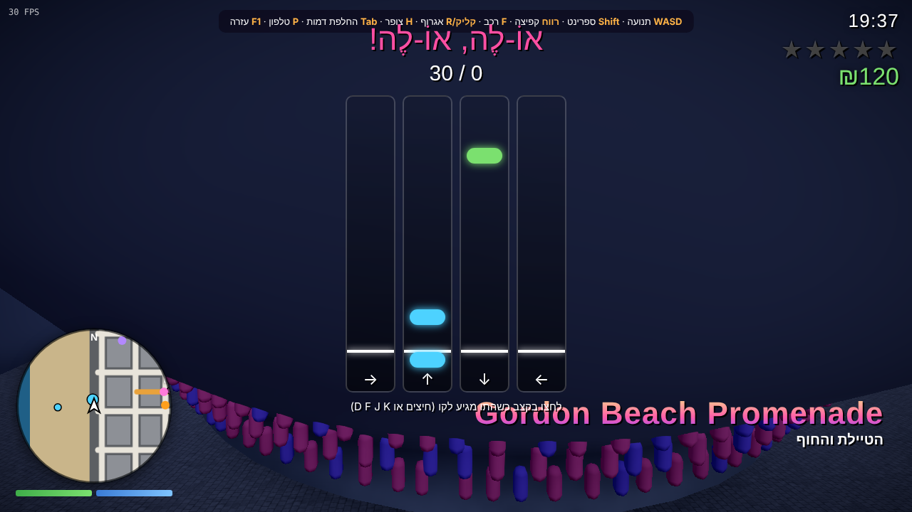
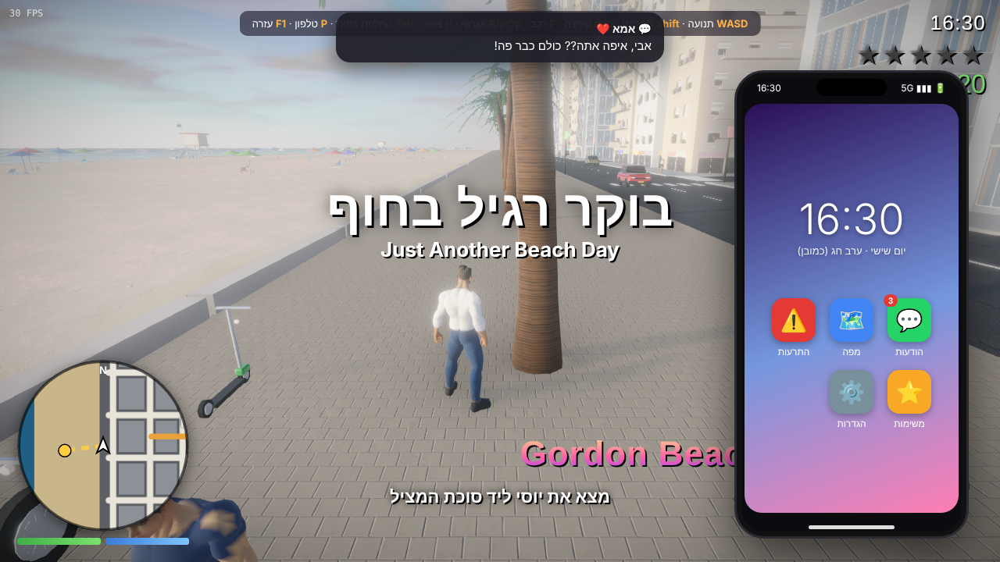
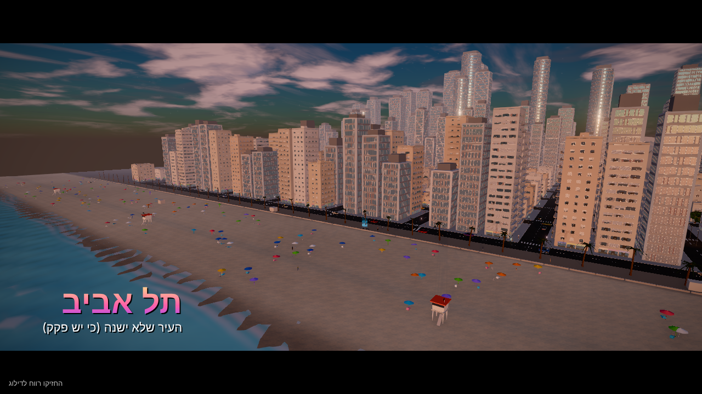
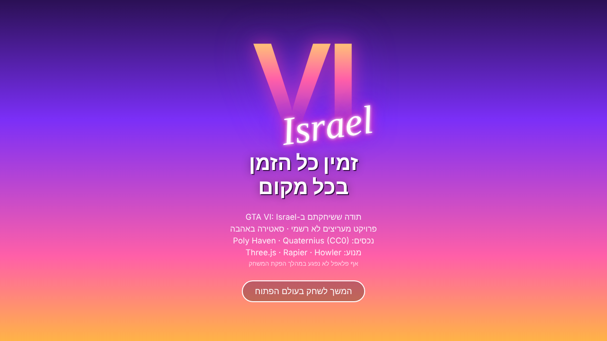
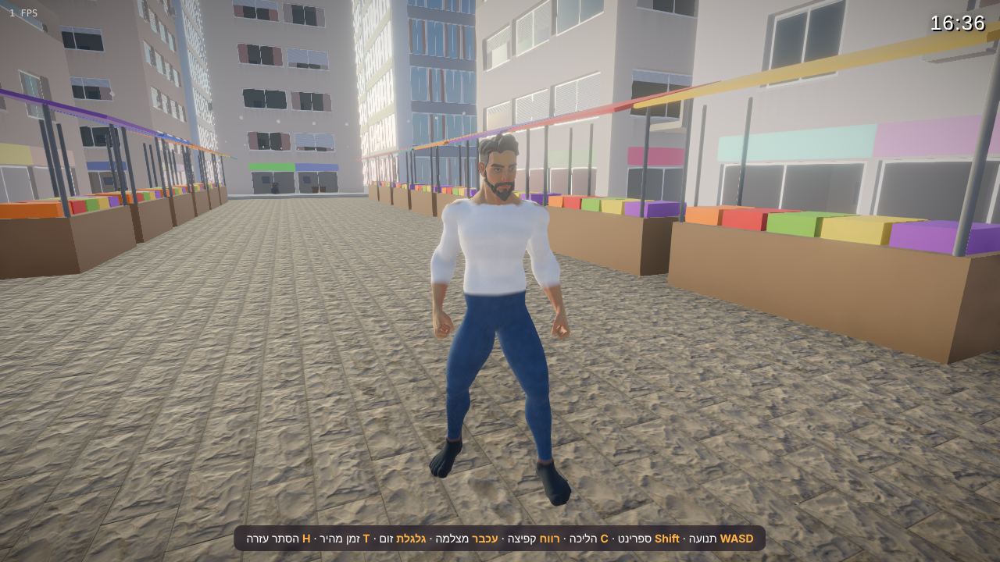
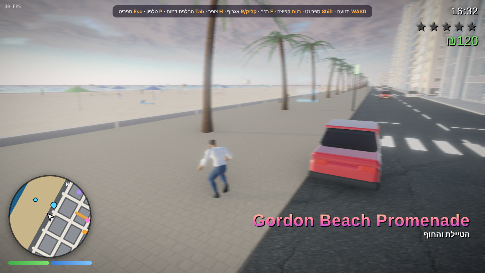

<div dir="rtl">

# GTA VI: Israel 🌴🇮🇱

**משחק עולם פתוח סאטירי בדפדפן**: פרודיה חמה ומוגזמת על חיי היומיום בישראל.
אבי רק רוצה להגיע לאירוע המשפחתי בירושלים עד 20:00. העיר, כרגיל, חושבת אחרת.

> *"זמין כל הזמן, בכל מקום"*


| | |
|---|---|
|  |  |
|  |  |
|  |  |
|  |  |
|  |  |

## מה יש במשחק

### העולם
- **4 אזורים רציפים** שאפשר ללכת, לנסוע או לטוס ביניהם:
  - 🏖️ **הטיילת והחוף**: שמשיות, מיטות שיזוף, סוכות מציל (עם דגל שחור), דקלים, ים עם גלים וקצף, מסלול המראה על החול
  - 🥙 **השוק**: דוכנים צבעוניים, שרשראות אורות, "פלאפל אבי" עם שיפוד שווארמה מסתובב, כיסאות פלסטיק לבנים (מודל אמיתי)
  - 🛣️ **נתיבי איילון**: 8 נתיבים עם פקק קבוע וגלי עצור-וסע, רכבת באמצע, שלטים ("חיפה – בעוד 3 שעות")
  - 🏛️ **ירושלים העתיקה**: חומות עם צינות ושערים, סמטאות מאבן ירושלמית, כיפות, עצי זית וברושים
  - וגם: **העיר הלבנה** (באוהאוס, מרפסות ודוד שמש על כל גג), **מגדלים** ליד איילון, **כביש 1** שעולה בהרים, **אצטדיון**
- **גרפיקה**:
  - טקסטורות PBR מצילומים (CC0).
  - חלונות עם חדרים "אמיתיים" מאחורי הזכוכית (interior mapping), תריסים, מזגנים ושלטי חנויות.
  - עננים פרוצדורליים.
  - צללים רכים (AO), זוהר (bloom), טשטוש תנועה (motion blur), ערפל חום.
  - גרייד צבע סגול-ורוד בשקיעה.
- **יום ולילה ומזג אוויר**: שקיעה מעל הים, חלונות שנדלקים, פנסים עם בריכות אור, ובנוסף מצבים של בהיר, שרב (אובך וערפל חום) וגשם.
- **החיים בעיר**:
  - תנועה עם רמזורים ופקקים, מבוססת מודל עקיבה (IDM).
  - הולכי רגל ותיירים שבורחים מרכבים.
  - שוטרים שרודפים כשמגיעים ל-2 "כוכבי עצבים" ומחלקים דו"חות.

### משחקיות
- **תנועה**: הליכה, ג'וגינג, ספרינט, קפיצה, טיפוס על מדפים ושחייה.
- **כלי רכב**: מכונית, האצ'בק, מונית, ניידת (עם סירנה), אוטובוס, אופנוע, קורקינט, אופניים חשמליים, ומטוס קטן עם מצב טיסה.
- **נהיגה בסגנון ארקייד** על פיזיקת Rapier: מתלים, דריפט עם בלם יד, צפצוף צמיגים, צופר.
- **HUD בסגנון GTA**:
  - מיני-מפה מסתובבת עם מסלול.
  - מדי בריאות ואנרגיה, ⭐ "כוכבי עצבים" ושקלים.
  - כתוביות ובאנר אזור.
  - הודעות "משימה הושלמה / נכשלה".
- **טלפון בתוך המשחק (P)**: הודעות, מפה עם סימון יעד, אפליקציית התראות, רשימת משימות עם אפשרות לשחק שוב, והגדרות.
- **מיני-משחקים**:
  - 🏓 **מטקות**: תזמון וקצב, הראלי מאיץ.
  - 🏃 **ריצה למקלט**: התראה רגועה בטלפון, ספירה לאחור, מקלטים ציבוריים במפה. מוצג בכבוד: בלי פיצוצים ובלי פאניקה.
  - 🚗 **פקק באיילון**: מד סבלנות, החלפת נתיבים וצופרים.
  - 🪑 **קטטת "מה הצבעת?"**: קרב קומי בסגנון קריקטורה עם בועות POW, כוכבי סחרחורת וכיסאות פלסטיק עפים (Rapier). בלי דם.
  - 🏟️ **אצטדיון**: מסדרון אוהדים עם להבות ומצב קצב בארבעה נתיבים.
- **חנויות**:
  - דוכן בגדים: צבע חולצה ומכנסיים.
  - מוסך: צבע לרכב, טורבו ותיקון.

### סיפור (8 משימות)
דמות ראשית: **אבי**. דמות משנה מתחלפת (Tab): **נועה**, קורקינטיסטית שתמיד נקלעת לבלגן.

1. **בוקר רגיל בחוף**: אמא מתקשרת, ואחריה סיבוב מטקות עם יוסי
2. **פלאפל בסכנה**: מרדף ברגל אחרי גנב הקופה של משה בשוק
3. **גנב הקורקינטים** (נועה): מרדף על אופניים חשמליים
4. **מה הצבעת?!**: לחלץ את יוסי מקטטה המונית בחוף
5. **התרעה** (נועה): להגיע למרחב מוגן בזמן, בשקט ובסדר
6. **שעה אפס באיילון**: לשרוד את הפקק בלי לאבד את העצבים
7. **המשחק הגדול** (נועה): לשיר בקצב באצטדיון
8. **ירושלים של שקיעה**: כביש 1 נגד השעון עד 20:00, ומשם הסיום המשפחתי

**קטעי מעבר ודיאלוגים**:
- הקטעים בנויים על ציר זמן עם תנועות מצלמה (dolly, crane, orbit, over-the-shoulder), חיתוכים, letterbox ושינויי תאורה.
- הדיאלוגים נמצאים ב-JSON (`src/data/dialogs.json`), עם כתוביות ודיבוב TTS מקומי (כשיש במערכת קול עברי).
- הפתיחה: מסך שחור, לוגו VI Israel, ואז פאן אווירי. הסיום: הלוגו עם הסלוגן.

### מולטיפלייר
- **שרת authoritative** (Node.js + ws):
  - הלקוח מנבא את התנועה מקומית (client-side prediction) ומתיישר מול השרת (reconciliation).
  - שחקנים אחרים מוצגים באינטרפולציה של 100ms.
- **חדרים**: עד 8 שחקנים, צ'אט (Enter), ובחירת אווטאר (אבי, נועה או אקראי).
- **מצבים**: עולם פתוח, **מירוץ איילון** (שערים, ספירה לאחור ומנצח), ו**ארנה "מה הצבעת?"** (השרת מכריע מי פגע במי ומי נוקאאוט).

## הרצה מקומית

דרוש Node.js בגרסה 22 ומעלה.

```bash
npm install
```

```bash
npm run dev
```

אחרי זה פותחים את http://localhost:5173

### שרת מולטיפלייר

```bash
npm run server
```

השרת מאזין ב-`ws://localhost:8787`. בתוך המשחק: Esc ← מולטיפלייר ← התחבר. פרמטר `?server=ws://host:8787` ממלא את כתובת השרת מראש.

עם Docker:

```bash
docker build -t gta-israel-server .
```

```bash
docker run -p 8787:8787 gta-israel-server
```

כשהמשחק מוגש ב-HTTPS (למשל ב-GitHub Pages), השרת צריך להיות זמין ב-`wss://`, כלומר מאחורי reverse proxy עם TLS.

### בנייה לפרודקשן

```bash
npm run build
```

```bash
npm run preview
```

### פריסה ל-GitHub Pages
ה-workflow `.github/workflows/deploy.yml` בונה ומפרסם בכל push ל-`main`. צריך להפעיל פעם אחת: **Settings ← Pages ← Source: GitHub Actions**.

## שליטה

| פעולה | מקלדת ועכבר | שלט |
|---|---|---|
| תנועה ונהיגה | WASD | סטיק שמאלי, RT/LT |
| מצלמה | עכבר (לחיצה לנעילה) / חיצים | סטיק ימני |
| ספרינט / הליכה איטית | Shift / C | RB / הטיה חלקית |
| קפיצה, טיפוס, בלם יד | רווח | A |
| כניסה ויציאה מרכב | F | Y |
| אגרוף | קליק / R | X |
| פעולה / סירנה | E | B |
| צופר | H | L3 |
| החלפת דמות | Tab | Select |
| טלפון | P | D-pad ↑ |
| תפריט והגדרות | Esc | Start |
| מטוס | W/S מצערת · A/D גלגול · ↑/↓ עלרוד · Q/E הגה | |
| זמן מהיר / מזג אוויר | T / Y | |

בנייד מופיעים ג'ויסטיק וירטואלי וכפתורים.

### פרמטרים ב-URL
`?spawn=jerusalem` (או `beach`, `promenade`, `market`, `ayalon`, `route1`, `stadium`, `airfield`) · `?hour=21` · `?char=noa` · `?quality=low|medium|high` · `?nointro` · `?autostart` · `?server=ws://…` · `?touch`

## מבנה הקוד

```
src/
  core/       Game (לולאה ומערכות), Input (מקלדת/עכבר/שלט/מגע), Fx (חלקיקים, מזג אוויר, אפקטים)
  world/      Terrain, City (בונה העיר), Materials (שיידר חזיתות), Foliage, Props, DayNight, Clouds, Sea, Colliders
  render/     Textures, GltfInstances, Post (AO/Bloom/AgX/Grade/MotionBlur/Haze/SMAA), Particles
  physics/    Physics (Rapier)
  vehicles/   VehicleKits (מודלים), Vehicle (נהיגה/טיסה), VehicleSystem, Traffic (IDM + רמזורים)
  entities/   SkinnedCharacter (דמויות + בגדים + אנימציות), PlayerController, Pedestrians
  camera/     FollowCamera
  missions/   MissionManager (מנוע משימות), missions (8 המשימות)
  minigames/  Matkot, Shelter, AyalonJam, Brawl, Stadium, Activities (חנויות), common
  story/      Dialog (כתוביות/TTS), Cutscene (ציר זמן), Intro (פתיחה/סיום)
  net/        NetClient (prediction / reconciliation / interpolation)
  ui/         Hud, MapRender, Phone, Menu, Loading, TouchControls
  audio/      Audio (צלילים מסונתזים דרך Howler)
  data/       dialogs.json, tips.json
shared/       terrain + protocol (משותף ללקוח ולשרת)
server/       שרת המולטיפלייר
```

## סטאק
TypeScript · Vite · Three.js (WebGL2) · postprocessing + N8AO · Rapier (WASM) · Howler.js · Zustand · Node.js + ws

## נכסים ורישיונות
- הקוד: MIT.
- נכסים (כולם CC0, ונשמרים בריפו תחת `public/assets`): טקסטורות ומודלים מ-[Poly Haven](https://polyhaven.com), דמויות ואנימציות מ-[Quaternius](https://quaternius.com). פירוט ב-`public/assets/CREDITS.md`.
- הבניינים, הצמחייה, הרכבים, הצלילים והשלטים נוצרים פרוצדורלית.

## גבולות תוכן
- סאטירה על חיי היומיום, לא תעמולה ולא פגיעה בקבוצות או באנשים אמיתיים.
- אלימות קומית בלבד, בלי דם וגור.
- אירועי חירום מוצגים בכבוד.
- אין שימוש בדמויות, לוגואים או מותגים מוגנים. הלוגו והעיצוב מקוריים, בהשראה בלבד.
- פרויקט מעריצים לא רשמי, ואינו קשור ל-Rockstar Games או לכל גורם אחר.

## מצב הפרויקט
מה הושלם ומה פושט נמצא ב-[ROADMAP.md](ROADMAP.md).

</div>
