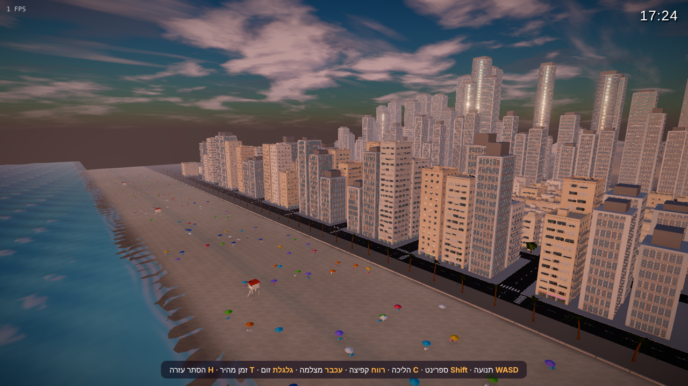
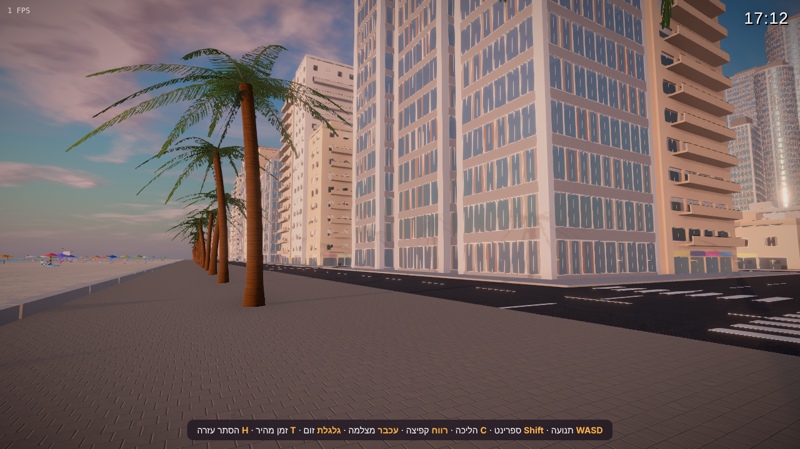
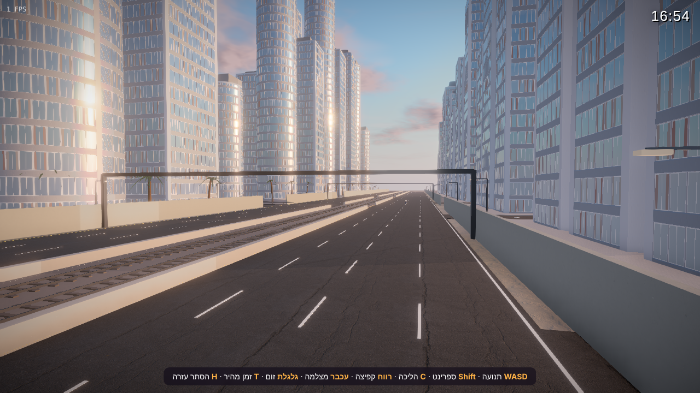
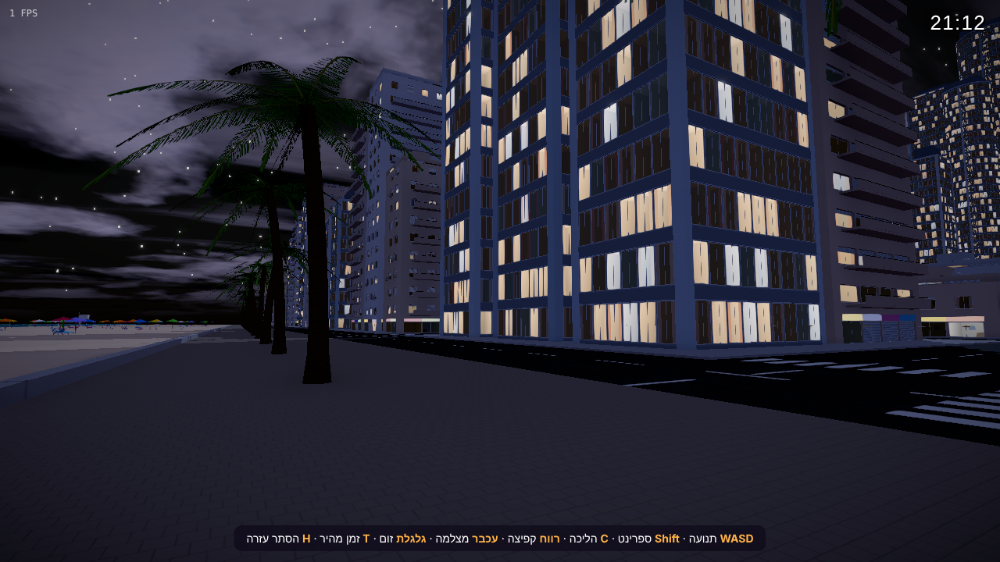

<div dir="rtl">

# GTA VI: Israel 🌴🇮🇱

**משחק עולם פתוח סאטירי בדפדפן** – פרודיה חמה ומוגזמת על חיי היומיום בישראל.
אבי רק רוצה להגיע לאירוע המשפחתי בזמן. העיר, כרגיל, חושבת אחרת.

> *"זמין כל הזמן, בכל מקום"*



## מה יש כרגע (שלב 1 + סבב גרפיקה)

- **עולם פרוצדורלי** (seeded, זהה לכל השחקנים) עם 4 אזורים שאפשר ללכת ביניהם:
  - 🏖️ **טיילת וחוף** – שמשיות, מיטות שיזוף, סוכות מציל (עם דגל שחור, כמובן), דקלים, ים עם גלים וקצף
  - 🥙 **השוק** – דוכנים צבעוניים, סוככים, שרשראות אורות, דוכן "פלאפל אבי" עם שיפוד שווארמה מסתובב וכיסאות פלסטיק לבנים
  - 🛣️ **נתיבי איילון** – 8 נתיבים, מסילת רכבת באמצע, קירות אקוסטיים, שלטי הכוונה ("חיפה – בעוד 3 שעות")
  - 🏛️ **ירושלים העתיקה** – חומות עם צינות ושערים, סמטאות צפופות מאבן ירושלמית, כיפות, עצי זית וברושים על הרי יהודה
  - **כביש 1** שעולה מאיילון לירושלים לאורך הגבעות
- **העיר הלבנה** – בנייני באוהאוס עם מרפסות, ודוד שמש על כל גג (חובה)
- **מחזור יום/לילה** – שמיים פיזיקליים, שקיעה מעל הים, חלונות שנדלקים בלילה, כוכבים, תאורת רחוב, ערפל אטמוספרי
- **דמות ראשית: אבי** – דמות מרוגדת (CC0, Quaternius) עם שלד מלא ואנימציות אמיתיות: עמידה, הליכה, ג'וגינג, ספרינט, קפיצה, נחיתה, שחייה. הבגדים (חולצה לבנה, ג'ינס, נעליים) נוצרים בשיידר לפי משקלי העצמות
- **גרפיקה**: טקסטורות PBR אמיתיות מצילומים (Poly Haven, CC0) – טיח, אבן ירושלמית, אספלט, חול, מרצפות; חלונות שקועים עם חדרים "אמיתיים" מאחורי הזכוכית (interior mapping), תריסים, מזגנים, שלטי חנויות; עננים פרוצדורליים; פוסט-פרוססינג: AO, bloom, AgX tone mapping, color grading סגול-ורוד, SMAA
- **תנועה**: הליכה, ריצה, קפיצה, טיפוס על מדפים (עד 2.3 מ'), שחייה בים, התנגשויות עם בניינים
- **מצלמת גוף שלישי** בסגנון GTA – מסלול עם עכבר, זום, offset כתף, מעקב אוטומטי, ומניעת חדירה לקירות
- **שלט (Gamepad)** + מקלדת ועכבר
- מסך טעינה עם לוגו VI Israel וטיפים סאטיריים, באנר שם אזור בסגנון GTA

| | |
|---|---|
|  |  |
|  |  |
|  | |

## הרצה מקומית

דרוש Node.js 20+.

```bash
npm install
npm run dev
```

ואז לפתוח את http://localhost:5173

בנייה לפרודקשן:

```bash
npm run build
npm run preview
```

### פרמטרים ב-URL (לבדיקות)

| פרמטר | דוגמה | משמעות |
|---|---|---|
| `spawn` | `?spawn=jerusalem` | נקודת התחלה: `beach`, `market`, `ayalon`, `route1`, `jerusalem` |
| `hour` | `?hour=21` | שעה ביום (0–24) |
| `char` | `?char=noa` | דמות: `avi` או `noa` |
| `autostart` | `?autostart` | דילוג על מסך הפתיחה |
| `quality` | `?quality=low` | בלי AO, צללים ברזולוציה נמוכה (למחשבים חלשים) |

בקונסול: `__game.teleport('market')`, `__game.setHour(5.5)`.

## שליטה

| פעולה | מקלדת/עכבר | שלט |
|---|---|---|
| תנועה | WASD | סטיק שמאלי |
| מצלמה | עכבר (לחיצה לנעילת סמן) / חיצים | סטיק ימני |
| ספרינט | Shift | RB / L3 |
| הליכה איטית | C / Ctrl | הטיה חלקית של הסטיק |
| קפיצה / טיפוס | רווח | A / ✕ |
| זום | גלגלת | D-pad למעלה/למטה |
| זמן מהיר | T | – |
| הסתר עזרה | H | – |

## מבנה הקוד

```
src/
  core/       Game (לולאה, רנדרר), Input (מקלדת/עכבר/שלט)
  world/      Terrain, City (בונה העיר), Props, Materials (שיידר חזיתות), DayNight, Sea, Colliders
  entities/   CharacterModel (דמות + אנימציה), PlayerController
  camera/     FollowCamera
  ui/         Hud, Loading
  assets/     registry – החלפת מודלים פרוצדורליים ב-GLTF בהמשך
  state/      store (Zustand)
  data/       tips.json
```

**נכסים**: טקסטורות ומודלים מ-Poly Haven ודמויות/אנימציות מ-Quaternius, כולם CC0 ושמורים בריפו (`public/assets`, פירוט ב-`public/assets/CREDITS.md`). את הטקסטורות של Poly Haven אפשר להוריד מחדש עם `node scripts/fetch-assets.mjs`. בניינים, צמחייה ושלטים נוצרים פרוצדורלית. כדי להחליף ב-GLTF, רושמים factory ב-`src/assets/registry.ts`
(`registerModel('id', () => ...)`) – קוד המשחק לא צריך להשתנות.

## סטאק

TypeScript · Vite · Three.js (WebGL2) · postprocessing + N8AO · Zustand. בשלבים הבאים: Rapier (פיזיקה), Howler.js (סאונד), Node.js + WebSocket (מולטיפלייר).

## גבולות תוכן

סאטירה על חיי היומיום – לא תעמולה ולא פגיעה בקבוצות או באנשים אמיתיים. אלימות קומית בלבד, בלי דם.
אירועי חירום מוצגים בכבוד. אין שימוש בדמויות, לוגואים או מותגים מוגנים – הכל מקורי, בהשראה בלבד.
זהו פרויקט מעריצים לא רשמי ואינו קשור ל-Rockstar Games או לכל גורם אחר.

## רישיון

MIT – ראו [LICENSE](LICENSE).

</div>
